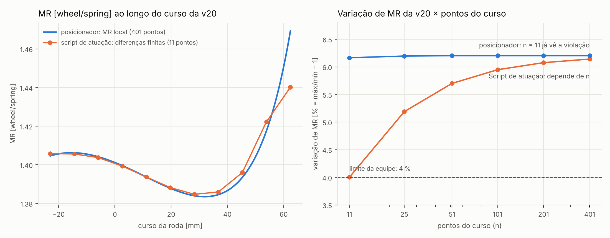
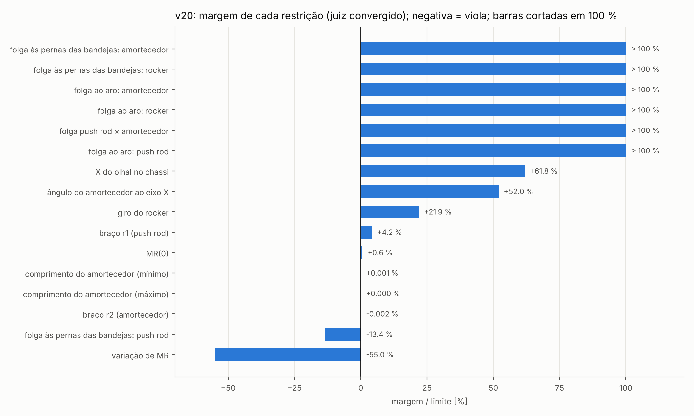
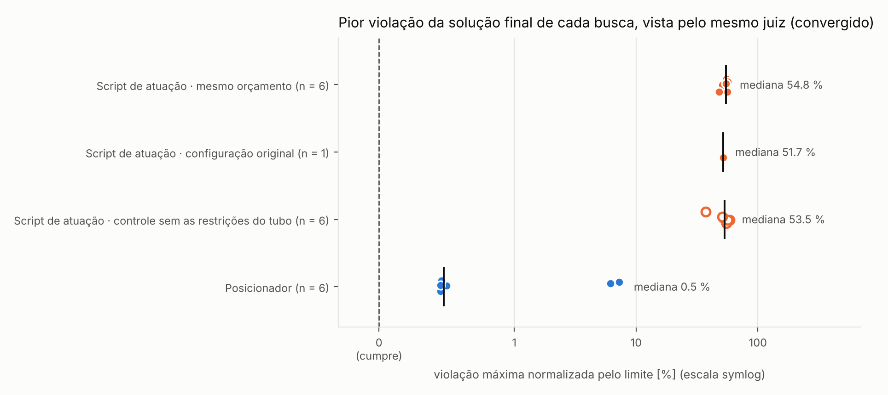
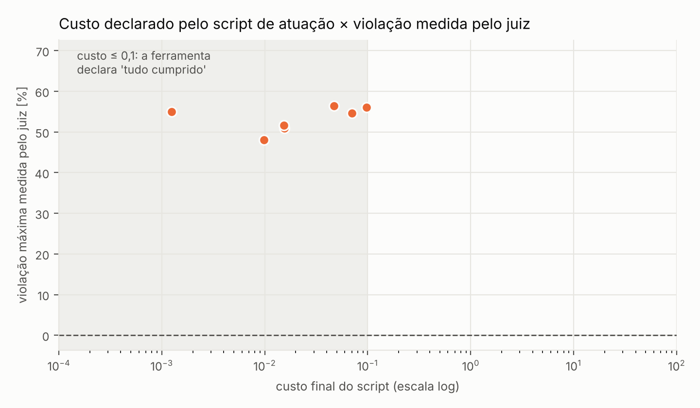
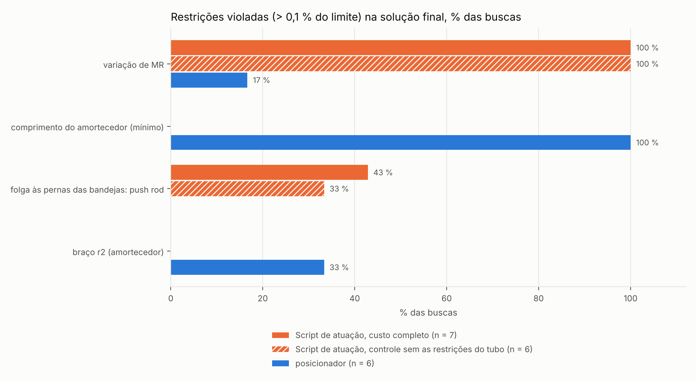
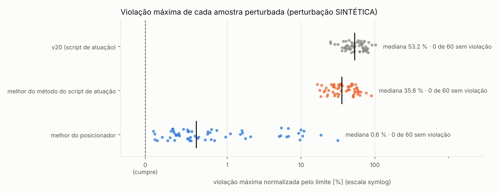

# Benchmark: script de atuação × posicionador da atuação (EDR-076)

Gerado em 2026-11-24 01:13:10 · Linux-6.18.44-fc-v819-x86_64-with-glibc2.39 · 4 núcleos · Python 3.13.18 · código do posicionador no commit `6b53511` · script de atuação: `t11_atuacao.py` sha256 `ceaea43831aa6d23…` (fora do repositório). Validation = NOT_VALIDATED: o juiz e as duas ferramentas usam cinemática ainda não comparada com o OptimumKinematics (REFERENCE, EDR-004); o que segue mede **consistência e cobertura**, não correção física. (Unidades da tabela da v20 em SI: m, rad.)

## Em linguagem simples: o posicionador é melhor que a v20?

**Resposta curta: no que mede e no quanto chega perto das metas, sim. Como solução pronta, nenhuma das duas serve ainda.**

### O que está sendo comparado

- A **v20** é uma posição de push rod, rocker e amortecedor, encontrada pelo **script de atuação** (`t11_atuacao.py`).
- O **posicionador** é outra ferramenta, que também procura essas posições.
- Para comparar com justiça, as duas foram **medidas pela mesma régua** (a avaliação do posicionador, que repete a medida até ela parar de mudar) e receberam **o mesmo número de tentativas**.

### Onde está a diferença: o tamanho da régua

O motion ratio (MR) é quanto a roda anda para cada milímetro do amortecedor, e a equipe quer que ele varie **no máximo 4 %** ao longo do curso.

Para saber quanto ele varia, é preciso medir em vários pontos do curso. O script de atuação mede em **11 pontos**. É como medir a inclinação de uma ladeira olhando só 11 pontos: entre eles a rampa pode subir e ele não vê.

| Resolução da medida | Variação de MR da v20 |
|---|---|
| Script de atuação, 11 pontos (onde ele otimiza) | **4,0 %** (parece cumprir) |
| Script de atuação, 25 pontos | 5,2 % |
| Script de atuação, 401 pontos | 6,1 % |
| Posicionador (já com 11 pontos) | **6,2 %** (não cumpre) |

Ou seja: a v20 passa na prova **com a régua curta** e reprova com a régua certa. E como o script **para de procurar quando a régua curta diz que está bom**, ele não percebe que ainda não chegou.

### O placar

| Pergunta | Script de atuação (v20) | Posicionador |
|---|---|---|
| A medida da variação de MR está certa? | Não: dá 4,0 % quando é 6,2 % | Sim: confere com 401 pontos |
| Quão longe das metas fica a solução final? | cerca de **55 %** fora do limite | cerca de **0,5 %** fora do limite |
| Quantas das buscas terminam a menos de 1 % das metas? | 0 de 13 | 4 de 6 |
| Existe solução que cumpre tudo? | Nenhuma | Nenhuma |
| Quanto tempo leva uma busca? | 128 a 196 s | 268 a 284 s (cerca de 1,7 vez mais) |

### O que cada uma "pede" e o que cada uma "ganha"

**O script de atuação pede** (e o posicionador não):
- um tubo de montagem encostado no Front Hoop (a menos de 8 mm do tubo existente);
- o push rod dentro do triângulo da bandeja superior;
- o gabarito do regulamento visto de frente, numa altura fixa.

**O posicionador pede** (e o script não):
- não bater em nenhuma peça do CAD do chassi;
- o gabarito com altura livre, a zona da AIP, o tirante e o esterçamento;
- que o resultado só valha depois de a medida convergir;
- dizer de onde vem cada limite e o que ficou sem verificar.

**O que o script de atuação ainda ganha:**
- a v20 foi pensada junto com o chassi (o tubo no Front Hoop);
- ele é mais rápido por busca.

**O que o posicionador ganha:**
- mede a variação de MR corretamente;
- chega perto das metas (o que sobra é o amortecedor 0,7 mm abaixo do mínimo, de 61 mm de curso);
- confere colisão com o CAD real, coisa que o script não faz;
- quando não acha solução, diz **quais metas brigam entre si**.

### O que isso quer dizer na prática

1. **O problema, com as metas atuais, não tem solução em nenhuma das duas ferramentas.** O conflito é entre "variação de MR de até 4 %" e "usar o curso inteiro de 61 mm do amortecedor". Nas melhores buscas do posicionador, ele vale cerca de **0,7 mm de curso**. Relaxar essa ordem de grandeza (hipótese, ainda não testada) pode tornar o problema viável. A decisão é da equipe.
2. **A v20 não cumpre a meta de variação de MR.** Isso aparece quando a medida usa mais pontos.

### Três cuidados para ler este resultado

- **Primeiro resultado com dados do T11, mas não validado.** Os dados são reais (geometria v10, v20 e o STEP do chassi). A cinemática das duas ferramentas ainda não foi comparada com o OptimumKinematics: elas concordam entre si (diferença de 1e-9 m), o que não prova que estão certas.
- **A comparação de busca foi feita sem o CAD** (só o aro). Com o CAD do chassi e 200 amostras, o posicionador também não encontrou posição viável. A vantagem de conferir colisão com o chassi está na tabela da seção 5, não nos gráficos da seção 2.
- **Poucas buscas** (7 do script de atuação, 6 de controle e 6 do posicionador): é um retrato, não uma estatística. O quanto da diferença vem da régua, do método de busca ou da região de partida está explicado na seção "O que o benchmark não prova".


## Resumo técnico

- **Mesma v20, dois olhares.** O script de atuação mede a variação de MR da v20 em 4,00 % (11 pontos, a resolução em que otimiza) e 5,19 % (25 pontos); com 401 pontos o mesmo estimador chega a 6,14 %. O posicionador mede 6,16 % já com 11 pontos. O limite da equipe é 4 %. Custo que o script dá à v20: 0,073.
- **Busca, mesmo juiz.** Com 6 partidas por ferramenta e orçamento igual de avaliações do mecanismo (~1500), a violação mediana da solução final é 54,8 % no método do script de atuação, 53,5 % no mesmo método sem as restrições que o posicionador não tem (controle) e 0,480 % no posicionador. Soluções praticamente cumpridas pelo juiz (violação ≤ 1 % do limite): 0 de 6 (script de atuação), 0 de 6 (controle) e 4 de 6 (posicionador). Soluções que o juiz aprova (VIAVEL ou CONDICIONAL): 0 das 13 do script de atuação e 0 das 6 do posicionador.
- **Cumprido segundo quem?** 7 das 7 buscas do script terminaram com custo ≤ 0,1 (que ele lê como 'tudo cumprido'); o juiz reprova 7 delas. O posicionador só devolve candidato depois da avaliação convergida, e quando não há candidato devolve o diagnóstico.
- **Custo.** Uma avaliação: 0,109 s (Script de atuação, 11 pontos) contra 0,126 s (posicionador, n = 11), com mais verificações por avaliação (tabela abaixo).

## Método

- **Juiz único.** Toda solução, de qualquer ferramenta, é reavaliada por `varredura.avaliar_convergido` na cena sem CAD (só o aro), com `mecanismo.construir` e o r2 da própria solução (o juiz não o recalcula) e o olhal posto pela regra do posicionador (|B(−23 mm) − C| = 210 mm). Violação = máx. de max(0, −folga)/|limite| (limite nulo: 1 mm).
- **Orçamento igual.** Método do script de atuação: Nelder-Mead do próprio script (mesmos `xatol`, `fatol`, `adaptive`) com `maxfev` = 1500; posicionador: 300 amostras, 20 refinos de até 60 avaliações (≤ 1500 avaliações rápidas, n = 11). Mais uma busca do script de atuação com a configuração original dele (`maxiter` 2000), sem limite de avaliações.
- **Controle.** O script de atuação também otimiza restrições que o posicionador removeu de propósito (a reta do tubo ao Front Hoop, a folga do tubo ao gabarito, o triângulo da bandeja superior e o gabarito projetado em Z fixo), e o juiz não as mede. Para não favorecer o posicionador, cada partida do script de atuação roda também com esses termos satisfeitos por construção (`sem_tubo`), sem alterar o script dele. O custo próprio dessas buscas exclui os termos do tubo.
- **Partidas.** A primeira do script de atuação é a v20; as demais são a v20 mais uma perturbação **SINTÉTICA** (σ = 10 mm no pivô, 2° nos ângulos, 3 mm nos braços). O posicionador usa as sementes 0 a 5 na caixa derivada do envelope do chassi (HIPOTESE, R8): X ±150 mm, Y 0 a 326 mm, Z 60 a 1257 mm.
- Amostras pequenas: nenhuma estatística inferencial; as tabelas listam cada busca. As buscas rodaram em 4 processos em paralelo, então os tempos incluem contenção de núcleos.

## 1. A mesma v20, dois olhares



O estimador do script (`np.gradient` sobre os pontos do curso) suaviza a curva: com poucos pontos ele subestima a variação, e é nessa resolução (11 pontos) que o otimizador decide. A conferência da reimplementação contra o `avaliar()` do script bate (4,0035 % e 5,189 %, diferença < 1e-9).



| restrição (v20, juiz convergido) | estado | valor | limite | violação |
|---|---|---|---|---|
| MR(0) | OK | 1,4012 | [1,39; 1,41] | — |
| variação de MR | VIOLADA | 0,062004 | 0,04 | 55,01 % |
| comprimento do amortecedor (máximo) | OK | 0,21 | 0,21 | — |
| comprimento do amortecedor (mínimo) | OK | 0,149 | 0,149 | — |
| braço r1 (push rod) | OK | 0,076658 | [0,055; 0,08] | — |
| braço r2 (amortecedor) | VIOLADA | 0,080002 | [0,055; 0,08] | 0,0021 % |
| giro do rocker | OK | 0,81809 | 1,047 | — |
| ângulo do amortecedor ao eixo X | OK | 0,2513 | 0,5236 | — |
| folga ao aro: push rod | OK | 0,080421 | 0,01 | — |
| folga ao aro: rocker | OK | 0,21446 | 0,01 | — |
| folga ao aro: amortecedor | OK | 0,22783 | 0,01 | — |
| folga às pernas das bandejas: push rod | VIOLADA | 0,0043311 | 0,005 | 13,38 % |
| folga às pernas das bandejas: rocker | OK | 0,18539 | 0,005 | — |
| folga às pernas das bandejas: amortecedor | OK | 0,19366 | 0,005 | — |
| folga ao tirante: push rod | OK | 0,03194 | 0 | — |
| folga ao tirante: rocker | OK | 0,24224 | 0 | — |
| folga ao tirante: amortecedor | OK | 0,28799 | 0 | — |
| folga push rod × amortecedor | OK | 0,10395 | 0,005 | — |
| X do olhal no chassi | OK | 0,1529 | 0,4 | — |

## 2. Busca lado a lado, mesmo juiz



| ferramenta | busca | avaliações | tempo [s] | custo próprio | veredito do juiz | violação máx. | variação de MR | restrições violadas (> 0,1 %) |
|---|---|---|---|---|---|---|---|---|
| script de atuação | v20 (sem perturbação) · mesmo orçamento | 1500 | 176 | 0,0156 | INVIAVEL | 50,9 % | 6,04 % | 1 |
| script de atuação | início 1 (v20 + perturbação SINTÉTICA) · mesmo orçamento | 1090 | 128 | 0,0978 | INVIAVEL | 56,0 % | 6,24 % | 2 |
| script de atuação | início 2 (v20 + perturbação SINTÉTICA) · mesmo orçamento | 1348 | 156 | 0,0012 | INVIAVEL | 55,0 % | 6,20 % | 1 |
| script de atuação | início 3 (v20 + perturbação SINTÉTICA) · mesmo orçamento | 1500 | 172 | 0,0098 | INVIAVEL | 48,1 % | 5,92 % | 2 |
| script de atuação | início 4 (v20 + perturbação SINTÉTICA) · mesmo orçamento | 1500 | 166 | 0,0468 | INVIAVEL | 56,4 % | 6,26 % | 2 |
| script de atuação | início 5 (v20 + perturbação SINTÉTICA) · mesmo orçamento | 1500 | 164 | 0,0705 | INVIAVEL | 54,6 % | 6,19 % | 1 |
| script de atuação | v20 · configuração original do script (maxiter 2000) | 1753 | 196 | 0,0153 | INVIAVEL | 51,7 % | 6,07 % | 1 |
| script de atuação | v20 (sem perturbação) · sem as restrições do tubo | 1500 | 170 | 0,0434 | INVIAVEL | 51,7 % | 6,07 % | 1 |
| script de atuação | início 1 (v20 + perturbação SINTÉTICA) · sem as restrições do tubo | 1500 | 170 | 0,0146 | INVIAVEL | 58,8 % | 6,35 % | 1 |
| script de atuação | início 2 (v20 + perturbação SINTÉTICA) · sem as restrições do tubo | 1500 | 171 | 0,0241 | INVIAVEL | 37,1 % | 5,49 % | 2 |
| script de atuação | início 3 (v20 + perturbação SINTÉTICA) · sem as restrições do tubo | 1500 | 170 | 0,0017 | INVIAVEL | 55,2 % | 6,21 % | 1 |
| script de atuação | início 4 (v20 + perturbação SINTÉTICA) · sem as restrições do tubo | 1500 | 172 | 0,0468 | INVIAVEL | 56,4 % | 6,26 % | 2 |
| script de atuação | início 5 (v20 + perturbação SINTÉTICA) · sem as restrições do tubo | 1500 | 172 | 0,0529 | INVIAVEL | 50,8 % | 6,03 % | 1 |
| posicionador | semente 0 | 1500 | 282 | — | INVIAVEL | 0,455 % | 3,87 % | 1 |
| posicionador | semente 1 | 1500 | 281 | — | INVIAVEL | 6,2 % | 4,14 % | 3 |
| posicionador | semente 2 | 1500 | 284 | — | INVIAVEL | 0,498 % | 3,78 % | 1 |
| posicionador | semente 3 | 1500 | 275 | — | INVIAVEL | 0,462 % | 3,47 % | 1 |
| posicionador | semente 4 | 1500 | 274 | — | INVIAVEL | 0,454 % | 3,61 % | 1 |
| posicionador | semente 5 | 1500 | 268 | — | INVIAVEL | 7,3 % | 2,96 % | 2 |





## 3. Robustez a perturbação dos pontos (SINTÉTICA)

As soluções são a v20 e a melhor solução final de cada método (menor violação pelo juiz, seção 2; o veredito nominal de cada uma está na tabela dela). O gráfico mostra a distribuição da pior violação sob perturbação: uma solução que já viola na posição nominal só é robusta no sentido de projeto se a distribuição ficar em 0.

Perturbação uniforme de ±1 mm no pivô, ±0,5° nos ângulos e ±0.5 mm nos braços, 60 amostras por solução, avaliação n = 11. Os valores **não são a tolerância de fabricação da equipe** (a medir).



## 4. Custo de uma avaliação

| avaliação | tempo mediano [s] |
|---|---|
| script avaliar (11 pontos) | 0,109 |
| script avaliar (25 pontos) | 0,197 |
| posicionador avaliar (n = 11) | 0,126 |
| posicionador avaliar (n = 25) | 0,282 |
| posicionador avaliar (n = 51) | 0,551 |
| posicionador convergido | 0,820 |

As avaliações não fazem o mesmo trabalho: a do posicionador confere mais restrições (tirante, 4 pernas por distância exata, convergência) e a do script confere o tubo ao Front Hoop e o triângulo da bandeja superior.

## 5. O que cada ferramenta verifica

Conferido contra o código das duas em 2026-11-23 (script de atuação: `custo()` e `avaliar()`).

| verificação | script de atuação | posicionador |
|---|---|---|
| MR alvo (1,40 ± 0,01) | sim; diferenças finitas sobre 11 pontos | sim; MR local (`motion_ratio`) |
| Variação de MR ≤ 4 % | sim; avaliada em 11 pontos (vê 4,00 %) | sim; convergida (n e 2n, até 200 pontos) |
| Comprimento e curso do amortecedor | sim; penalidade quadrática com tolerância | sim; desigualdade (+ margem de curso, a confirmar) |
| Braços do rocker, giro, ângulo do amortecedor a X | sim; penalidade | sim; desigualdade |
| Folga ao aro | sim, mas no segmento errado (`PO = UO`) | sim; segmento real, aro movido com a manga |
| Folga às pernas das bandejas | só as 2 da superior; 21 pontos por segmento | as 4; distância exata |
| Push rod × amortecedor | sim | sim |
| Tirante de direção | não | sim (raio do tirante a confirmar: eixo) |
| Esterçamento (curso × esterço) | não: só rodas retas | sim, se o curso da cremalheira for informado |
| Obstáculos do chassi (STEP) | não: uma reta ao Front Hoop, sem tubos | sim: folga ≥ 0 a todo obstáculo fixo |
| Gabarito T.1.2 | parcial: projeção YZ, Z fixo em 550 mm | altura livre (T.1.2.2c); NAO_VERIFICAVEL sem coluna e pedal |
| Zona da AIP (F.8.6.1) | não | sim; NAO_VERIFICAVEL sem a posição da face |
| Manga, freio e pinça | não | declarado NAO_VERIFICAVEL |
| Fixação em tubo ou nó | impõe um tubo ao Front Hoop (≤ 8 mm) | só preferência por nó; não impõe tubo |
| Push rod dentro do triângulo da bandeja superior | sim | não (não migrado) |
| Resolução do curso conferida | não | sim |
| Procedência de cada limite | não | sim (origem e fonte; A_CONFIRMAR liga CONDICIONAL) |

## Leitura

Rótulos: **[código]** resultado desta rodada; **[inferência]** conclusão minha; **[hipótese]** ainda não testada.

### O que o benchmark mostra

1. **[código] As duas ferramentas veem a v20 de jeito diferente.** O script de atuação mede a variação de MR em 4,00 % na resolução
   em que otimiza (11 pontos); o mesmo estimador sobe para 6,14 % com 401 pontos, valor que o posicionador já lê com 11 (6,16 %).
   O limite da equipe é 4 %.
2. **[código] Nenhuma das 19 soluções finais é aprovada pelo juiz** (13 do método do script de atuação, contando o controle, e 6 do
   posicionador): todas saem INVIAVEL. O problema, com as metas atuais, continua sem solução nas duas ferramentas.
3. **[código] A distância até cumprir é muito diferente.** Violação mediana da solução final: 54,8 % no método do script de atuação, 53,5 % no
   controle e 0,5 % no posicionador (cerca de 100 vezes menos); 4 das 6 buscas do posicionador ficam a menos de 1 % do limite,
   contra nenhuma das 13 do script de atuação.
4. **[código] O custo final do script não mede o que ele diz medir.** Em 7 de 7 buscas com a configuração dele, o custo final ficou
   em 0,0012 a 0,098 (ele lê custo próximo de 0 como "tudo cumprido") e o juiz reprova as 7, com variação de MR de 5,9 a 6,3 %.
5. **[código] O controle descarta a explicação mais cômoda.** Sem as restrições que o posicionador removeu (tubo ao Front Hoop,
   folga do tubo ao gabarito, triângulo da bandeja superior, gabarito projetado), o método do script de atuação continua em 37 a 59 %. A
   diferença não vem dessas restrições.
6. **[código] O que sobra no posicionador é pequeno e específico.** Em 4 das 6 buscas a única restrição violada é o comprimento
   mínimo do amortecedor, 0,68 a 0,74 mm abaixo de 149 mm (curso de 61 mm), com a variação de MR já em 3,47 a 3,87 %. Nas outras
   duas, o braço r2 passa de 80 mm e a variação de MR fica em 2,96 e 4,14 %.
7. **[código] Custo.** A avaliação de um candidato leva 0,126 s (posicionador, n = 11) contra 0,109 s (script, 11 pontos). Com o
   mesmo número de avaliações rápidas (1.500), cada busca do posicionador leva 268 a 284 s contra 128 a 196 s do script de atuação, cerca de
   1,7 vez mais tempo de parede (inclui o mapa de espaço livre e a reavaliação convergida dos finalistas, e a contenção dos 4
   processos em 4 núcleos).
8. **[código] Robustez (perturbação SINTÉTICA).** Mediana da pior violação nas amostras perturbadas: 0,6 % no melhor do
   posicionador, 35,8 % no melhor do script de atuação e 53,2 % na v20.

### O que ele sugere

- **[inferência]** O gargalo do método do script de atuação, nesta rodada, é a resolução em que ele mede a variação de MR: o otimizador para
  onde vê 4 %, e ali o MR real é 6 %. Com poucos pontos ele não tem como saber.
- **[hipótese]** Há um conflito pequeno entre "variação de MR ≤ 4 %" e "usar o curso inteiro de 61 mm do amortecedor": nas melhores
  buscas ele vale cerca de 0,7 mm de curso. Reduzir a exigência de curso nessa ordem, ou o curso de bump em cerca de 1 mm, pode
  tornar o problema viável. Não foi testado: é decisão da equipe e pode ser verificado trocando o valor em `config_T11.json`.

### O que o benchmark não prova

- **O juiz é do posicionador.** Ele usa o MR local do `kinematics_model` e a avaliação convergida. O estimador do script converge
  para o mesmo valor com muitos pontos (item 1), então a medida do juiz não é arbitrária. Mas o benchmark **não separa** quanto da
  diferença vem do estimador de 11 pontos, da construção do r2 pelo MR e da amostragem global do posicionador, ou da região de
  partida. O experimento que separaria: o método do script de atuação com 51 pontos ou mais.
- **Partidas diferentes.** As do script de atuação são a v20 perturbada (SINTÉTICA); as do posicionador, amostras na caixa derivada do
  envelope do chassi (HIPOTESE, R8). Amostras pequenas (7, 6 e 6 buscas): nenhuma estatística inferencial.
- **Sem CAD.** A cena tem só o aro. O benchmark compara as restrições compartilhadas de cinemática, não a colisão com o chassi, que
  é o que o posicionador faz e o script não (tabela da seção 5).
- **O juiz não mede** o que o script tem e o posicionador não (tubo ao Front Hoop, triângulo da bandeja superior, gabarito em Z
  fixo). O controle neutraliza isso na otimização, mas esses itens ficam sem medição.
- **Sem validação física.** As duas ferramentas usam cinemática consistente entre si (erro de 1e-9 m no comprimento do amortecedor,
  TC-POS-060), mas nenhuma foi comparada com o OptimumKinematics (REFERENCE, EDR-004). VERIFIED não é validado.
- **O orçamento é um teto.** O Nelder-Mead do script de atuação parou por convergência antes do limite em duas buscas (1.090 e 1.348
  avaliações); a busca com a configuração original dele gastou 1.753. O posicionador usou as 1.500 nas seis.
- **Tempos** medidos com 4 processos em 4 núcleos, numa máquina de nuvem; valem como ordem de grandeza.

### Como reproduzir

```
uv run python -X utf8 tools/benchmark_posicionador.py rodar --script-atuacao PASTA_DO_SCRIPT --saida docs/posicionador/benchmark
<python com matplotlib> tools/benchmark_posicionador.py relatorio --saida docs/posicionador/benchmark
```
A rodada completa leva cerca de 18 minutos em 4 núcleos. `resultados.json` guarda todos os números; este relatório e os gráficos
saem dele.

